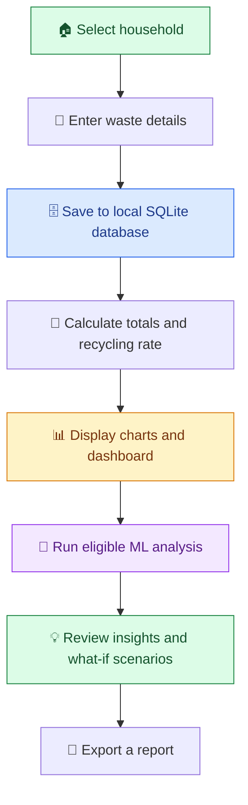

<div align="center">


<p>
  
  
  
  
</p>

### ♻️ Record waste · Understand patterns · Explore better habits

*An educational desktop application combining household waste tracking, visual analytics, practical suggestions, and introductory machine-learning features.*

</div>

---

## 🌎 About the Project

EcoTrack is the project-facing name used in this README. The supplied source-code explainer refers to the application as **EcoMind AI — Intelligent Waste Management System** and uses internal names such as `EcoMindApp` and `ecomind.db`. This README documents the functionality described in that explainer; the internal code/database names are not assumed to have been renamed.

The application helps a household or community organise waste records, see how much waste is marked as recycled, compare categories, and explore potential reduction scenarios. It stores information locally and uses charts and machine-learning routines to make recorded patterns easier to review.

<div align="center">
  
  <br>
  <sub>Small, informed choices can help build better waste habits.</sub>
</div>

> 🌱 **Project principle:** AI can help people notice patterns, but its predictions are estimates—not guarantees—and good decisions still depend on reliable records and human judgment.

## 🎯 Goals

- 📝 Record household waste by date, category, weight, and recycling status.
- 🗃️ Keep household records in a local SQLite database.
- ♻️ Calculate total waste, recycled waste, and recycling rate.
- 📊 Visualise category totals and waste trends.
- 💡 Present suggestions when recorded category totals are high.
- 🧪 Explore hypothetical waste-reduction scenarios.
- 🧠 Demonstrate introductory machine learning for anomaly detection, next-day waste estimation, and image-category prediction.

## ✨ Features

| Feature | What it does |
| --- | --- |
| 🏠 **Dashboard** | Shows total waste, recycled waste, recycling rate, highest-waste category, eco score, AI status, material flow, category distribution, and trends. |
| ➕ **Add Waste** | Records a house, date, category, weight, recycling status, optional description, and optional image. |
| 📊 **Waste Analytics** | Summarises waste totals and category-level patterns. |
| ♻️ **Recycling Tracker** | Helps review the amount of recorded waste marked as recycled. |
| 🧾 **History** | Displays saved records for review and management. |
| 📈 **Charts** | Uses bar charts for category totals and line charts for daily totals. |
| 🖼️ **Image Gallery** | Revisits images saved with waste records. |
| 💬 **Insight Report** | Summarises waste totals, leading categories, and suggestions when category totals are high. |
| 🧪 **What-if Lab** | Tests a hypothetical reduction percentage from 0% to 80% for a category or all categories. |
| 📄 **Word Export** | Exports a waste report as a Word document. |
| 📷 **Optional camera capture** | Detects a sufficiently large scene/background change and captures a frame for a record. |

## 🔄 How It Works



1. Choose a household and enter the waste date, category, weight, and recycling status.
2. Optionally add a description or an image/camera capture.
3. Save the record to the local SQLite database.
4. Review totals, recycling rate, category breakdowns, and charts.
5. When enough data is available, inspect anomaly flags, next-day estimates, or image-category predictions.
6. Use suggestions and the What-if Lab to consider possible waste reductions.
7. Export a waste report to a Word document when needed.

## 🧠 AI & Machine Learning

The project includes three different machine-learning tasks. They have different data requirements and should not be treated as equally ready at all times.

| Task | Model / method | Purpose | Minimum data described in the project guide |
| --- | --- | --- | --- |
| 🔎 Unusual-pattern detection | `IsolationForest` | Reviews daily totals, recycling rate, and category totals to flag a potentially unusual latest day. | At least **5 distinct dates**. |
| 📅 Next-day waste estimate | `RandomForestRegressor` | Uses the previous three daily totals and their average to estimate the next day's total. | At least **8 distinct dates**. |
| 🖼️ Image-category prediction | `RandomForestClassifier` | Learns from simple image features, including colour histograms and average variation, using saved labelled images. | At least **3 labelled images in each of at least 2 categories**. |

<div align="center">
  
  
  
</div>

### Important AI notes

- If the required data is not available, the application can report that the model is still learning or not ready.
- An anomaly flag means a day looks different from the recorded pattern; it does **not** prove that a record is wrong.
- Forecasts depend on the amount and quality of historical data and may be inaccurate.
- The image classifier uses relatively simple image features. It should not be described as a state-of-the-art deep-learning vision system.
- The camera routine detects a sufficiently large change against the background. It is **not** a general-purpose object detector; image classification is a separate step.

## 🧮 Core Calculations

The application’s ordinary metrics are calculated from saved records:

| Metric | Calculation |
| --- | --- |
| **Total waste** | Sum of the weights of the records included in the calculation. |
| **Recycled waste** | Sum of the weights of records marked as recycled. |
| **Recycling rate** | `recycled waste / total waste × 100`; returns `0` if total waste is zero. |
| **Highest-waste category** | Category with the largest combined recorded weight. |
| **Eco score** | The recycling rate capped at 100 in this version. It is a simplified project metric, not an official environmental certification. |

## 🗂️ Data Storage & Sample Records

- **Database:** `ecomind.db`, stored beside the Python script.
- **Images:** saved in the `waste_images` folder.
- **Storage type:** local SQLite database; the described application does not itself provide cloud synchronisation or a shared online database.
- **Default data:** when the database is first created, the program seeds **five default houses and ten example waste records** dated **1–5 October 2026**.
- **Existing database behaviour:** if a database already contains houses, the seed routine does not add that starter set again.

> ⚠️ The starter records are demonstration data, not real household measurements. Check the database before presenting screenshots or metrics as real-world results.

## 🧱 Project Architecture

| Component | Responsibility |
| --- | --- |
| **Database layer** | Creates/updates SQLite tables and stores households and waste records. |
| **Analytics** | Calculates totals, recycling rate, category totals, highest category, and the simplified score. |
| `EcoMindMLEngine` | Prepares daily data and runs anomaly detection, next-day estimation, and image classification. |
| `WasteVision` | Uses OpenCV and a webcam to detect scene changes and save a frame. |
| `EcoMindApp` | Builds the PyQt6 desktop interface, handles user input, and refreshes screens. |
| `GraphWindow` / charts | Uses Matplotlib to display category and date-based charts. |

## 🛠️ Technology Stack

<div align="center">
  
</div>

| Technology | Role |
| --- | --- |
| 🐍 **Python** | Main programming language and application logic. |
| 🪟 **PyQt6** | Desktop windows, forms, buttons, navigation, and dialogs. |
| 🗄️ **SQLite3** | Local relational storage for households and waste records. |
| 🔢 **NumPy** | Numerical arrays and feature preparation. |
| 🧠 **scikit-learn** | `IsolationForest`, `RandomForestRegressor`, and `RandomForestClassifier`. |
| 📷 **OpenCV (`cv2`)** | Image processing and webcam capture. |
| 📈 **Matplotlib** | Charts displayed in the desktop application. |
| 📄 **python-docx** | Word-document report export. |

## 🚀 Getting Started

The supplied explainer identifies `main.py` as the source script and lists the technologies above, but it does **not** provide a confirmed dependency file or exact installation command. Use the following as a starting point and adjust it to match the repository you distribute.

### Prerequisites

- Python installed on your computer.
- The project source file `main.py`.
- The required packages installed in the Python environment.
- A webcam only if you want to use camera capture.

### 1. Get the project files

Place `main.py` and any accompanying project files in one folder. The app creates `ecomind.db` beside the script and saves images in `waste_images`.

### 2. Install dependencies

If the project includes a `requirements.txt`, use:

```bash
python -m pip install -r requirements.txt
```

If it does not, install the dependencies listed for the supplied application:

```bash
python -m pip install PyQt6 numpy scikit-learn opencv-python matplotlib python-docx
```

> 📦 Package installation may vary by Python version and operating system. The supplied explainer does not specify pinned package versions.

### 3. Run the application

```bash
python main.py
```

If your system uses `python3`, try:

```bash
python3 main.py
```

### 4. Explore the app

- 🏠 Open the dashboard and review the sample metrics.
- ➕ Add a waste record for a household.
- 📊 Inspect analytics, charts, history, and the recycling tracker.
- 🧪 Try the What-if Lab and report export.
- 🧠 Return after adding more records to see whether ML features have enough data to become ready.

## 📋 Suggested Project Structure

The guide confirms the main script, database name, and image folder. The exact repository tree was not included, so the layout below is a **suggestion**, not a verified listing.

```text
EcoTrack/
├── main.py
├── README.md
├── requirements.txt        # Add/maintain if used by your project
├── ecomind.db              # Created locally by the application
└── waste_images/           # Saved images; created/used by the application
```

## 🌍 Sustainability Connection

<div align="center">
  
  
  
</div>

The project conceptually relates to:

- **SDG 11 — Sustainable Cities and Communities**
- **SDG 12 — Responsible Consumption and Production**
- **SDG 13 — Climate Action**

These are conceptual connections, not a claim that the app is certified by or integrated with the United Nations or any municipal waste service.

## ⚠️ Limitations & Responsible Use

- Starter houses and waste records are demo data, not real measurements.
- Machine-learning results depend on the quantity, quality, and variety of recorded data and can be wrong.
- Image classification uses basic image features and needs enough labelled examples across multiple categories.
- Camera capture detects changes against a background; it does not independently identify every object in a scene.
- The eco score is a simplified recycling-rate metric, not a validated environmental rating.
- The described application is a local desktop app. Cloud sync, mobile access, and live waste-collection integrations are not demonstrated in the supplied guide.
- Use the model outputs as prompts for review, not as definitive evidence or guarantees.

## 🔮 Future Improvements

Possible extensions—if you choose to build them—include:

- ☁️ Optional cloud backup and synchronisation.
- 📱 A companion mobile interface.
- 🏘️ Community-level comparisons with suitable privacy protections.
- 🧠 More robust image models trained on a larger, carefully labelled dataset.
- 📉 More thorough model evaluation and clear confidence reporting.
- 🧪 Automated tests for calculations, database operations, and model readiness.
- 📤 Additional export formats such as CSV.
- ♻️ Locally tailored recycling guidance based on verified collection rules.

These are ideas for future development, not claims about current implementation.

## 🧪 Suggested Testing Checklist

- [ ] Add waste entries across multiple households.
- [ ] Verify total waste and recycled waste calculations.
- [ ] Verify recycling rate when total waste is zero.
- [ ] Check category totals and highest-waste category.
- [ ] Confirm records persist after restarting the app.
- [ ] Confirm optional images are saved and can be revisited.
- [ ] Test report export.
- [ ] Check ML status with fewer than the minimum required dates/images.
- [ ] Add enough data to test anomaly detection and next-day estimation.
- [ ] Review image predictions against known labelled examples.
- [ ] Test the What-if Lab at 0% and 80% reduction.

---

<div align="center">


### 🌿 EcoTrack ♻️

**Understand waste. Review patterns. Make better-informed choices.**

*An educational Python desktop project for household waste tracking and introductory AI/ML.*

</div>
